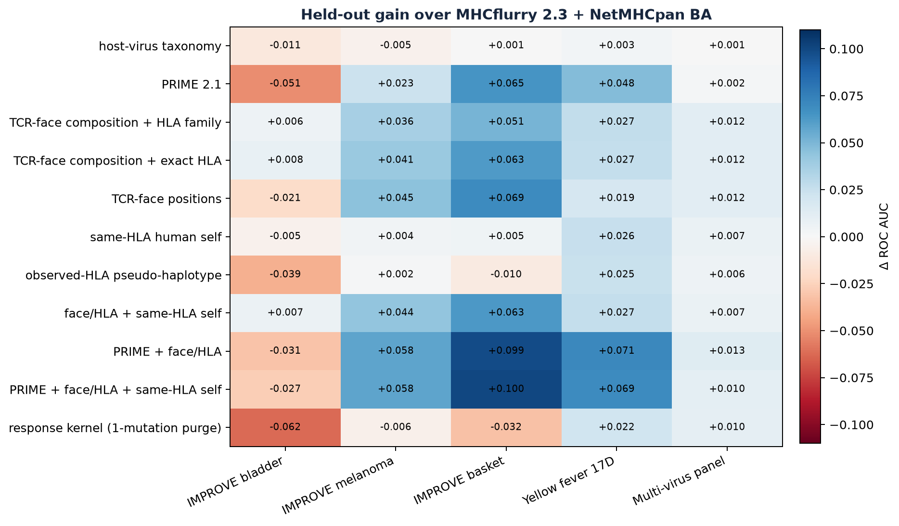
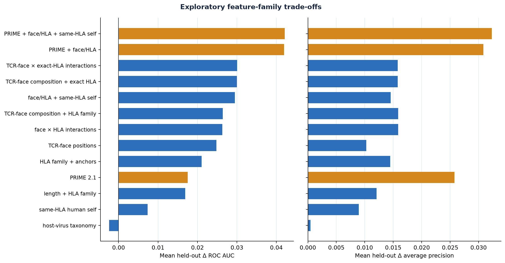
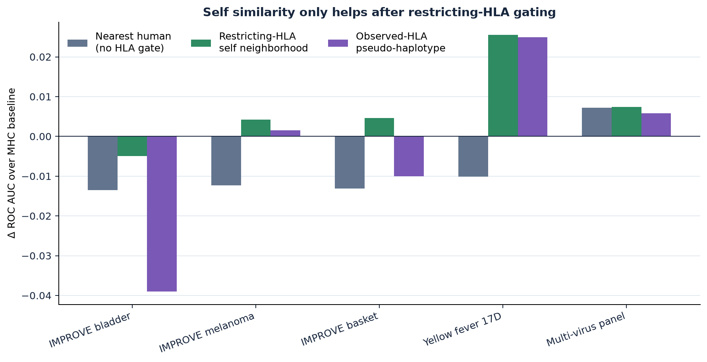
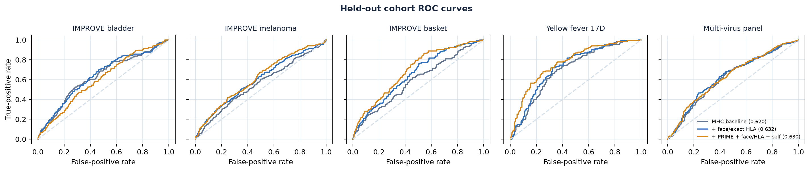

# TCR-visible non-self: held-out cohort diagnosis

## Outcome

The first representation that improves all five held-out cohorts is a strongly
regularized adapter containing peptide length, the exact HLA allele, P2/PΩ anchors, and
amino-acid composition across P3…PΩ−1. It adds **+0.0300 mean ROC AUC** and
**+0.0158 mean AP** over MHCflurry 2.3 presentation plus
NetMHCpan BA. Per-cohort Δ AUC ranges from +0.0082 to
+0.0625; all five point estimates are positive.

The exploratory highest macro endpoint is PRIME 2.1 plus that face/HLA adapter
and the continuous same-HLA self-neighborhood proxy: **+0.0421 mean Δ AUC**,
**+0.0323 mean Δ AP**, and
**-0.0352 mean Δ log loss**. It is not uniformly robust: bladder remains
negative (-0.0272 Δ AUC), so it should not replace the face/HLA-only model without new validation.

## What the ablations say

- Generic taxonomy is effectively null here (-0.0024 mean Δ AUC).
- Ungated nearest-human similarity is harmful in ranking (-0.0084), despite some AP/calibration gains.
- Conditioning the same candidate self peptides on the restricting HLA rescues the direction (+0.0074 mean Δ AUC; 4/5 positive cohorts).
- Pooling all observed group alleles as a pseudo-haplotype is worse (-0.0034); restricting-HLA selection is the better proxy. Viral group allele sets are incomplete, so this is an ablation rather than a definitive haplotype test.
- Exact-allele calibration beats two-digit HLA-family calibration; unseen held-out alleles are handled as unknown sparse categories. Position-specific face one-hot features are less stable than face composition. The benchmark supports residue weighting, but not a high-dimensional positional code at its present sample size.
- A response-positive BLOSUM cross-reactivity kernel fails even after removing exact and one-mutation neighbors (-0.0137). Known-responder similarity is cohort-biased here.

## Interpretation

“Foreign source” is not the quantity selected TCR repertoires see. A useful
feature must separate MHC-facing anchors from the exposed peptide face and ask
whether similar *presented* self ligands existed during selection. The data
support the first half strongly and the same-HLA self term weakly. They do not
support generic virus probability, raw distance to the human proteome, or
pooling every observed allele.

This is compatible with direct experimental and modeling work: PRIME combines
HLA presentation with residues at positions less important for HLA binding;
large TCR ligand screens find conserved central, up-facing motifs with more
tolerance at MHC-contact residues; and thymic-selection models predict fewer
available clones near displayed self. See the [PRIME2.0 study](https://pmc.ncbi.nlm.nih.gov/articles/PMC9811684/),
[direct TCR cross-reactivity mapping](https://pmc.ncbi.nlm.nih.gov/articles/PMC4071348/), and
[thymic selection model](https://pmc.ncbi.nlm.nih.gov/articles/PMC1857316/).

## Experimental adapters (not a recommended default)

The exact-HLA/TCR-face specification is fitted on all maintained data as
separate tumor and viral response adapters in `models/`. They require only
`peptide`, `hla`, `mhcflurry_2_3_0_presentation_score`, and
`netmhcpan_ba_rank`; `scripts/train_tcr_visible_response_adapter.py` also
provides the load-and-predict function. Training metrics in the model manifest
are descriptive—the held-out table in this report is the performance evidence.

## Validation boundary

All feature families and regularization choices in this report are exploratory.
PRIME has known training overlap with part of this benchmark. The self index is
reviewed human Swiss-Prot, candidate retrieval is approximate, and the thymic
proxy uses predicted binding under the restricting HLA rather than thymic
expression, peptide processing, or an observed TCR repertoire.

## External confirmation: failed

The frozen tumor adapter was scored once, unchanged, on TESLA and Braun, which
never entered fitting or selection (`scripts/evaluate_tcr_visible_external.py`,
[`tables/external_confirmation.csv`](tables/external_confirmation.csv)). Paired
group-bootstrap intervals are for AUC(adapter) − AUC(baseline).

| Endpoint | n (pos) | Adapter AUC | MHCflurry presentation AUC | Δ [95% interval] | NetMHCpan BA AUC | Δ [95% interval] |
|---|---:|---:|---:|---:|---:|---:|
| TESLA | 711 (33) | 0.673 | 0.841 | −0.168 [−0.264, −0.066] | 0.817 | −0.144 [−0.247, −0.055] |
| Braun, all | 112 (53) | 0.625 | 0.635 | −0.011 [−0.112, +0.079] | 0.644 | −0.020 [−0.088, +0.050] |
| Braun, frameshift | 19 (5) | 0.757 | 0.714 | +0.043 [−0.188, +0.214] | 0.729 | +0.029 [−0.067, +0.133] |

The within-IMPROVE gain does not transfer: on TESLA the adapter is significantly
worse than either raw MHC predictor, and on Braun it is indistinguishable from
them. The earlier “+0.030 mean AUC” is therefore a cross-cohort result within one
benchmark family, selected from many exploratory specifications, and must not be
read as evidence of a general improvement. Use MHC presentation/binding scores
directly for external neoepitope ranking; these adapters stay experimental.

## Figures

